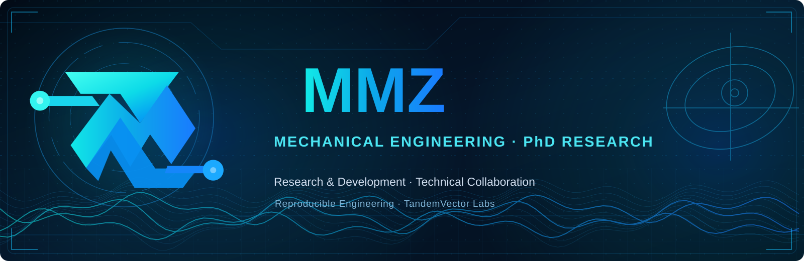

  

<h1 align="center">MMZ</h1>

<strong>Mechanical Engineering PhD candidate · Research & Development · Technical collaboration</strong>

  <a href="https://github.com/Usefull-Skills">TandemVector Labs</a> ·
  <a href="https://github.com/Usefull-Skills/.github/blob/main/PROJECT_CATALOG.md">Project directory</a> ·
  <a href="https://github.com/Usefull-Skills/.github/blob/main/CONTRIBUTING.md">Contribute</a>

## About

I am a mechanical engineering PhD candidate with an interest in **research and development** and collaborative technical work. Alongside [Aliakbar Emadoddin](https://github.com/GOD13emad), I am one of the two GitHub organization owners of **[TandemVector Labs](https://github.com/Usefull-Skills)**.

Our shared portfolio brings together engineering research, developer tooling, desktop experiences, and connectivity software. We emphasize reproducible work, clear technical documentation, responsible collaboration, and honest statements about project maturity.

## Explore the shared portfolio

| Area | Start here |
| :--- | :--- |
| **Research & engineering** | [TandemVector Labs](https://github.com/Usefull-Skills) — joint engineering and software R&D |
| **Projects & provenance** | [Public project directory](https://github.com/Usefull-Skills/.github/blob/main/PROJECT_CATALOG.md) — upstream sources, maturity, and release locations |
| **Desktop software** | [Remote Commander Browser](https://github.com/Usefull-Skills/remote-commander-browser) · [Appearance Studio Core](https://github.com/Usefull-Skills/AppearanceStudio-Core) |
| **Developer tools** | [ChatGPT Remote Commander — shared fork](https://github.com/Usefull-Skills/ChatGPTRemoteCommander) · [original upstream](https://github.com/GOD13emad/ChatGPTRemoteCommander) |
| **Collaboration & security** | [Contributing](https://github.com/Usefull-Skills/.github/blob/main/CONTRIBUTING.md) · [Governance](https://github.com/Usefull-Skills/.github/blob/main/GOVERNANCE.md) · [Security](https://github.com/Usefull-Skills/.github/blob/main/SECURITY.md) |

These links describe **shared organizational work**, not a claim that I personally authored every listed project. The personal repositories remain the original Git upstreams and existing official release locations where documented. Each project has its own license, current acceptance status, and supported platforms.

## Working together

For a feature, bug, or contribution, begin with the relevant organization repository and its issue tracker or pull requests. For confidential vulnerabilities, use that project's `SECURITY.md` instead of a public issue.

The organization currently uses the GitHub handle `Usefull-Skills`, with the shared public identity **TandemVector Labs**. The name represents a technical collaboration, not a claim of registered company status.

## فارسی

من **MMZ**، دانشجوی دورهٔ دکتری مهندسی مکانیک با تمرکز حرفه‌ای بر **پژوهش و توسعه** و همکاری‌های فنی هستم. به همراه [علی‌اکبر عمادالدین](https://github.com/GOD13emad) در مدیریت مشترک [TandemVector Labs](https://github.com/Usefull-Skills) مشارکت دارم.

برای آشنایی با پروژه‌ها و وضعیت واقعی نسخه‌ها، [فهرست پروژه‌های عمومی](https://github.com/Usefull-Skills/.github/blob/main/PROJECT_CATALOG.md) را ببینید. مالکیت کد، مجوزها و مرجع انتشار هر پروژه در مستندات خودش مشخص است.

---

Independent technical collaboration · Evidence-based engineering · Respect for original authorship and privacy

